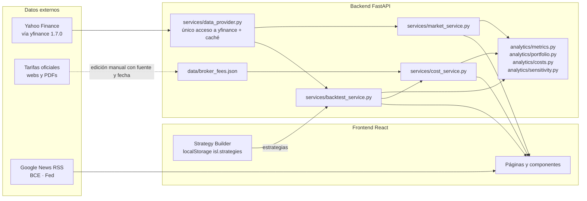
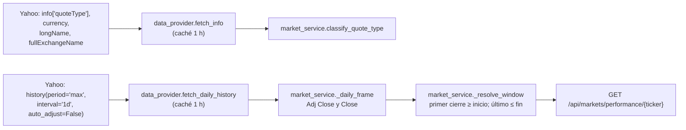
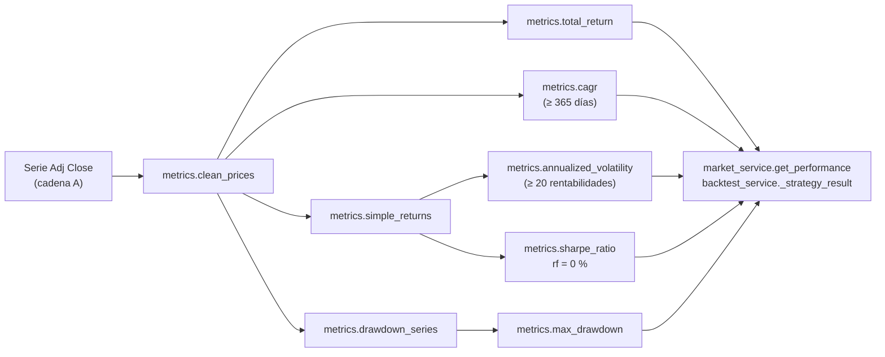
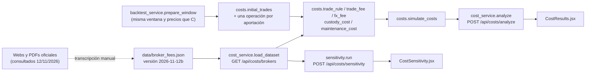
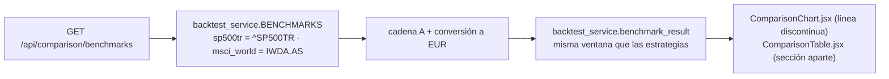
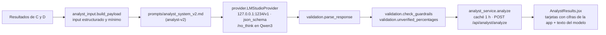

# Cadena de datos y reproducibilidad

Documento de la Fase 8 (2026-11-18). Describe de dónde sale cada cifra que muestra **Investment Strategy Lab**, cómo se transforma y cómo puede reproducirla un tercero.

## Qué entendemos por «cadena de datos trazable y reproducible»

La expresión es nuestra; no es una cita de ninguna fuente. La definimos así:

- **Trazable:** cada cifra mostrada se puede seguir hacia atrás hasta su origen:
  - el dato externo, con su fuente, campo, unidad y fecha;
  - la transformación aplicada (fórmula y supuestos);
  - el archivo y la función que la calculan;
  - el endpoint que la sirve;
  - el test que la comprueba.
- **Reproducible:** otra persona, con el mismo código, las mismas versiones de dependencias y los mismos parámetros, obtiene el mismo resultado. Hay dos excepciones, que se declaran:
  - las **fuentes externas cambian** (Yahoo corrige o amplía datos, las tarifas se actualizan);
  - ~~la parte generativa no es determinista~~ (ya no aplica: el AI Strategy Analyst se retiró en la Fase 8.1, D80).

Por eso aspiramos a una **trazabilidad completa y una reproducibilidad razonable, dadas las fuentes externas utilizadas**. No prometemos reproducibilidad exacta: el proyecto no congela una copia de los datos de Yahoo.

### Tres tipos de información

| Tipo | Qué es | Ejemplos | Cómo se controla |
|---|---|---|---|
| **Externa** | Dato que viene de fuera | Precios y tipos de cambio de Yahoo; tarifas oficiales; TER | Fuente, campo, unidad y fecha documentados en [[Datos y fuentes]] |
| **Derivada** | Cálculo determinista sobre datos externos y parámetros del usuario | Rentabilidad, CAGR, volatilidad, Sharpe, drawdown, valor de la cartera, costes | Funciones puras en `backend/analytics/`, con tests de resultado conocido |
| ~~Generativa~~ | Texto producido por un modelo de IA | 🔁 Solo existió en el AI Strategy Analyst, retirado en la Fase 8.1 (D80). **El producto final no tiene información generativa** | Ver cadena F (histórica) |

---

## Visión general

**Endpoints** (prefijos en `backend/main.py`):
- `/api/markets` → `search`, `quote/{ticker}`, `performance/{ticker}`, `ter/{ticker}`
- `/api/comparison` → `GET benchmarks`, `POST backtest`
- `/api/costs` → `GET brokers`, `POST analyze`, `POST sensitivity`
- `/api/news` → `categories`, `""` (portada), `search`

---

## Cadena A — Datos de mercado

| Elemento | Detalle |
|---|---|
| Fuente original | Yahoo Finance, a través de yfinance 1.7.0 (no oficial) |
| Campos | `Adj Close` (ajustado por splits y dividendos) y `Close` (solo splits); `quoteType`, `currency` |
| Unidad | Divisa de cotización del activo (`GBp`/`GBX`, `ZAc` e `ILA` se convierten con factor 0,01) |
| Fecha | Fecha local de cada mercado; consulta en el momento de la petición |
| Transformación | Recorte de la serie completa a la ventana pedida; sin inventar fines de semana ni festivos |
| Supuestos | `Adj Close` equivale a dividendos reinvertidos (D10, D19); los índices de Yahoo suelen ser de precio |
| Datos ausentes | Se eliminan, no se rellenan; sin `quoteType` → ticker inexistente (404) |
| Archivos | `services/data_provider.py`, `services/market_service.py` |
| Tests | `test_market_service.py`, `test_api.py`, `test_cache.py`; integración `test_integration_yahoo.py` |
| Limitación | Yahoo puede cambiar o corregir el histórico; sin sesgo de supervivencia controlado |

## Cadena B — Métricas

| Métrica | Fórmula | Cuándo no se calcula | Decisión |
|---|---|---|---|
| Rentabilidad total | P_fin / P_ini − 1 | < 2 cierres | D20 |
| CAGR | (P_fin / P_ini)^(1/años) − 1; años = días / 365,25 | < 365 días naturales | D20 |
| Volatilidad | desv. típica muestral de rentabilidades diarias × √252 (√365 en cripto) | < 20 rentabilidades | D20 |
| Sharpe | media · N / (desv. · √N), con rf = 0 % | vol. = 0 o pocos datos; «No aplica» en futuros | D71 |
| Máxima caída | mín(P_t / máx(P_0..P_t) − 1) | < 2 cierres | D20 |

- **Con aportaciones**, las métricas se calculan sobre un índice **TWR** (`portfolio.twr_index`). El dinero aportado se muestra aparte (D53).
- **Archivo:** `analytics/metrics.py`, funciones puras sin red.
- **Tests:** `test_metrics.py` (series sintéticas de resultado conocido, p. ej. 100 → 120 → 90 → 110 ⇒ máxima caída −25 %), `test_performance.py` y `test_phase7.py` (Sharpe).
- **Limitación:** rentabilidades simples, no logarítmicas (⏳ D20); Sharpe sin tasa libre de riesgo.

## Cadena C — Strategy Comparison

```mermaid
flowchart LR
  C0["StrategiesContext.jsx<br/>localStorage isl.strategies"] --> C1["comparisonApi.js<br/>POST /api/comparison/backtest"]
  C1 --> C2["backtest_service.run_comparison"]
  C2 --> C3["_load_asset / _load_fx<br/>(cadena A + EUR{CCY}=X)"]
  C3 --> C4["portfolio.to_base_currency<br/>precio_EUR = precio × factor ÷ EUR/divisa"]
  C4 --> C5["portfolio.align_prices<br/>intersección de fechas, sin forward-fill"]
  C5 --> C6["portfolio.contribution_flows<br/>portfolio.simulate (buy & hold)"]
  C6 --> C7["portfolio.twr_index → métricas (cadena B)"]
  C7 --> C8["ComparisonTable.jsx<br/>ComparisonChart.jsx"]
```

| Elemento | Detalle |
|---|---|
| Entradas del usuario | Activos, pesos, capital, aportaciones (activo, importe, frecuencia), periodo |
| Transformación | Conversión a EUR con el tipo de cambio del mismo día; intersección de fechas comunes; buy & hold sin rebalanceo; aportación en el siguiente día común (`add_months` con ajuste a fin de mes; la primera, un periodo después del inicio) |
| Supuestos | Participaciones fraccionarias; sin costes (van en la cadena D); tipo de cambio de mercado (cierre de Londres) frente a cierre de cada bolsa |
| Datos ausentes | Una fecha sin precio de algún activo se excluye para todos; si el periodo común no existe, estado «sin datos» explicado |
| Archivos | `services/backtest_service.py`, `analytics/portfolio.py` |
| Tests | `test_portfolio.py`, `test_backtest.py`, `test_contributions.py`; integración `test_integration_backtest.py`; E2E en `frontend/e2e` |
| Comprobación cruzada | Una estrategia 100 % un activo da las mismas métricas que Explore Markets; 100 % VOO en EUR = variación de VOO en USD combinada con EUR/USD ([[Bitácora]] §15) |
| Limitación | Periodo común limitado por el activo más reciente; no hay MWR/XIRR |

## Cadena D — Costes de intermediación

| Elemento | Detalle |
|---|---|
| Fuente original | Tarifas oficiales de 10 perfiles ([[Datos y fuentes]] §7), con URL y fecha por registro |
| Unidad | EUR; los umbrales y comisiones en otra divisa llevan `tier_ccy` / `fee_ccy` y se convierten con el tipo de Yahoo del día |
| Transformación | Comisión por operación (fija, %, mínimos, máximos, tramos, órdenes gratuitas al mes); custodia prorrateada por días con su periodicidad real; salida estimada aparte |
| Supuestos | Tarifa actual aplicada a todo el periodo histórico; interpretaciones ⏳ (D47, D56, D57); **el TER no se resta** (D42) |
| Datos ausentes | Mercado o instrumento no cubierto → «Datos incompletos» con el motivo |
| Archivos | `analytics/costs.py`, `services/cost_service.py`, `analytics/sensitivity.py` |
| Tests | `test_costs.py`, `test_cost_service.py`, `test_phase7.py`; integración `test_integration_costs.py` |
| Comprobación manual | ING: 2 × (3 € + 5 €) = 16 € y custodia 188,34 € ([[Bitácora]] §16); Bankinter: 122 × 20 € = 2.440 € ([[Errores de la IA]] E05) |
| Limitación | No hay *scraping*: si cambia una tarifa, hay que editar el JSON. Sin impuestos, spreads ni cánones |

**✅ Revisado y corregido en la Fase 8.1** (D81, [[Errores de la IA]] E31). Era un error real: ahora las ventas usan la regla y la divisa de venta. Texto original de la alerta:

**⚠ PENDIENTE DE REVISIÓN (posible error para revisión humana, no corregido):**
- en `analytics/sensitivity.py`, todas las órdenes de rotación, también las de venta, se valoran con la regla de comisión de **compra** (`trade_rule(schedule, "buy", …)`);
- en tarifas con comisión de venta distinta, la simulación podría diferir;
- no afecta al backtest histórico, que trata la venta aparte como coste de salida.

## Cadena E — Benchmark

| Elemento | Detalle |
|---|---|
| Fuentes | `^SP500TR` (índice *total return*, USD, desde 04/01/1988); `IWDA.AS` (ETF proxy del MSCI World, EUR, desde 25/09/2009) |
| Transformación | Buy & hold en euros, sin aportaciones ni costes, en la ventana exacta de las estrategias |
| Datos ausentes | Si el histórico no cubre el inicio → «no disponible»; no se acorta el periodo de las estrategias (D73) |
| Tests | `test_phase7.py`; E2E `frontend/e2e/phase7.spec.js` |
| Limitación | IWDA.AS ya descuenta su TER y tiene error de seguimiento; descartados `^GSPC` y `^990100-USD-STRD` por ser de solo precio (D72) |

## Cadena F — AI Strategy Analyst (generativa) — 🔁 histórica

> **Retirada del producto en la Fase 8.1** ([[Decisiones]] D80): los archivos de esta cadena ya no existen y la aplicación solo produce información externa y derivada (cadenas A–E). Se conserva como registro del experimento; los prompts están en `Histórico/AI Strategy Analyst/`.

| Elemento | Detalle |
|---|---|
| Entrada | Solo cifras ya calculadas (C y D), TER y perfil educativo opcional; nada de HTML, archivos ni datos personales ([[Datos y fuentes]] §8) |
| Transformación | Interpretación textual; **no calcula** |
| Controles | JSON con esquema; patrones prohibidos (recomendaciones, predicciones); ids de estrategia desconocidos; porcentajes no presentes en el input |
| Reproducibilidad | **No determinista.** Se versiona el prompt (`analyst-v2`) y el input; el modelo depende de lo que cargue el usuario en LM Studio |
| Archivos | `ai/analyst_input.py`, `ai/prompts.py`, `ai/prompts/`, `ai/provider.py`, `ai/validation.py`, `ai/analyst_service.py` |
| Tests | `test_analyst.py` (proveedor simulado); `test_integration_analyst.py` (modelo real, solo manual); E2E `ai-analyst.spec.js` simulado |
| Limitación | Pendiente de validación humana con un modelo real (Fase 6 🟦) |

---

## Cómo reproducir los resultados

1. **Entorno:** Python 3.11 con `pip install -r backend/requirements.txt` (versiones fijadas); `npm install` en `frontend/`.
2. **Arranque:** `start_backend.bat` y `start_frontend.bat` (ver `README.md`).
3. **Tests deterministas:** `python -m pytest` desde `backend/`, sin red; `npx vitest run` en `frontend/`.
4. **Para documentar un resultado** (p. ej. en la bitácora):
   - estrategias (activos, pesos, capital, aportaciones);
   - periodo y fechas efectivas que muestra la app;
   - intermediario y versión del dataset (`2026-11-12b`);
   - benchmark;
   - fecha de consulta;
   - captura de pantalla.
5. **Lo que puede cambiar al repetirlo otro día:** precios recientes, correcciones de Yahoo y tarifas vigentes.

## Limitaciones de reproducibilidad

- No hay copia congelada de los datos de mercado. Un resultado con «fin = hoy» cambia cada día.
- El proyecto **todavía no está bajo git** ([[Bitácora]] §21); el historial de versiones vive en [[Versiones]] y en esta documentación.
- La caché vive en memoria y se borra al reiniciar el backend.
- ~~El modelo local no viene incluido y cada usuario puede cargar uno distinto.~~ Ya no aplica: desde la Fase 8.1 la app no depende de ningún modelo de IA (D80).
